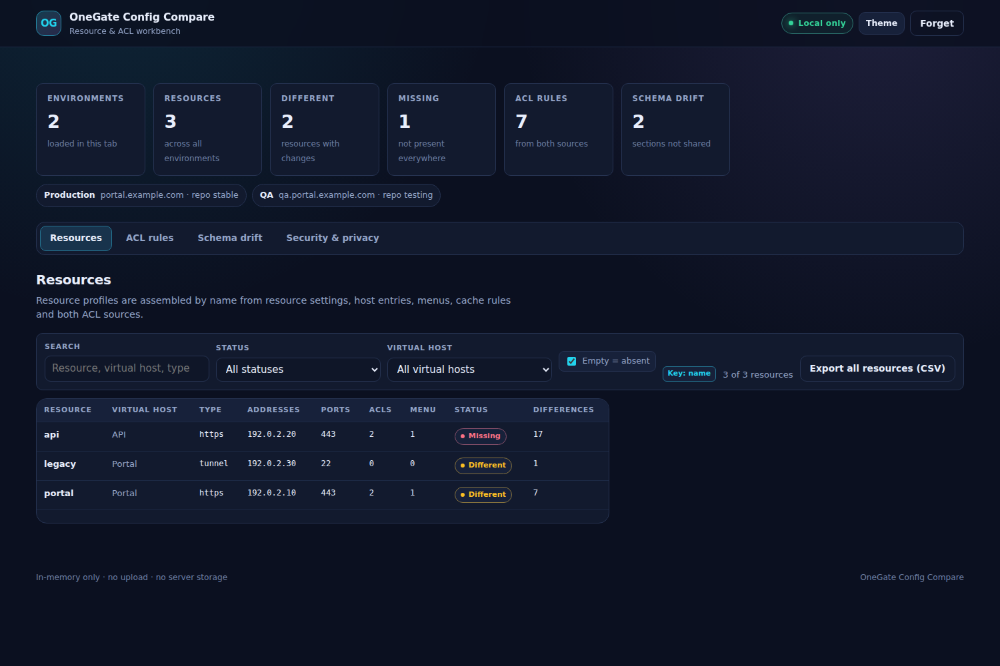
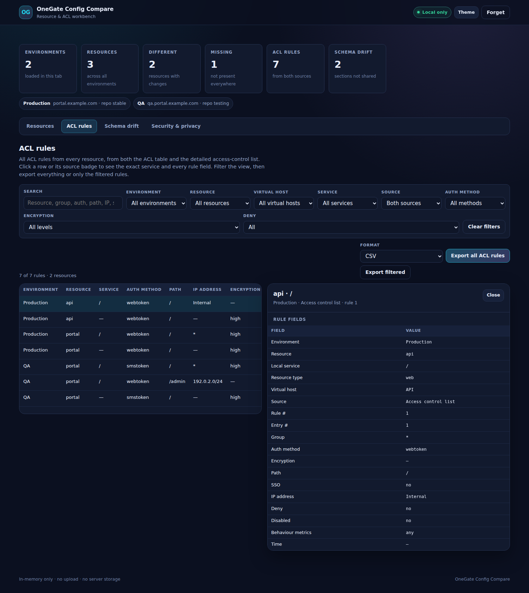
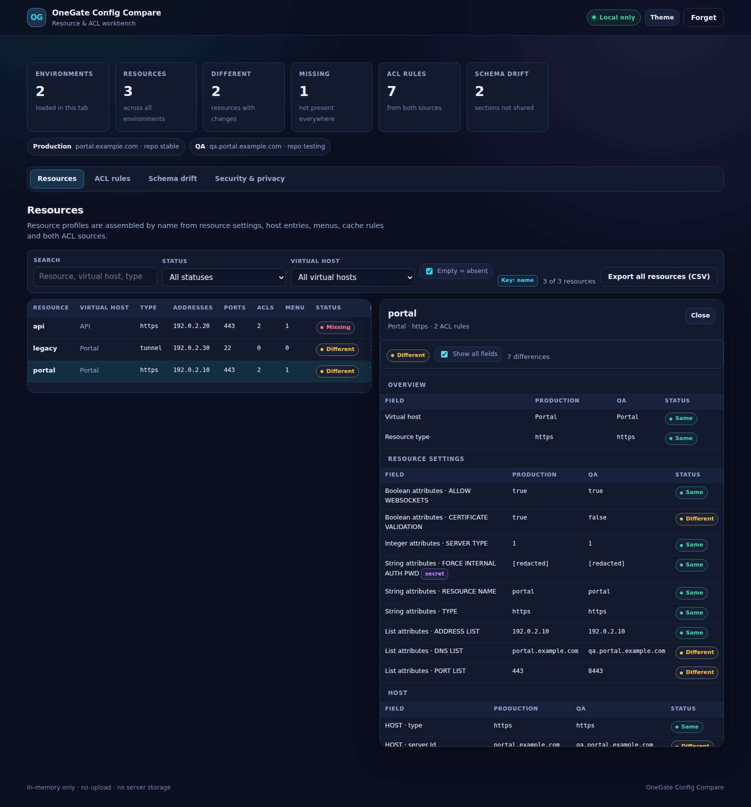
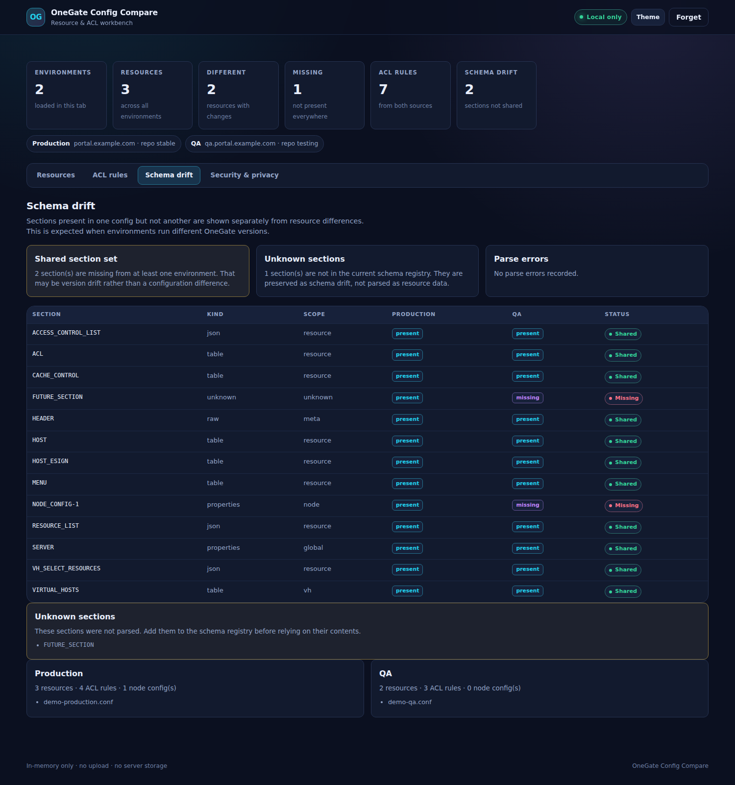
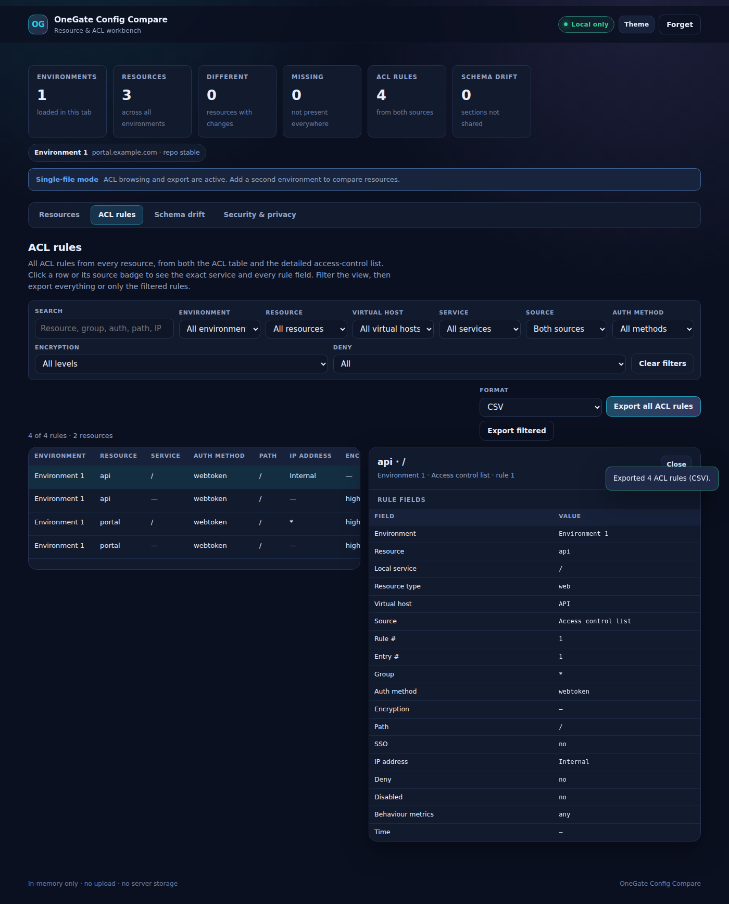

# OneGate Config Compare

**Find configuration drift between OneGate environments in the browser — without uploading configuration files or exposing secrets.**

> **Status: first release implemented.** The section-aware parser, resource comparison, global ACL view, CSV/HTML/JSON export and Docker packaging are in this repository. The first release focuses on resources and ACLs. Full global-setting diff, acceptance ledger/OK ticks and number-based matching are next.

## Quick start

### Docker Compose (recommended)

```bash
curl -O https://raw.githubusercontent.com/RogerBergling/OneGate-Conf/main/compose.yaml
docker compose up -d
```

Open <http://localhost:8008>.

The included `compose.yaml` pulls `ghcr.io/rogerbergling/onegate-conf:latest`, binds the port to `127.0.0.1` only, runs the container read-only, drops all capabilities and sets `no-new-privileges`. If the GHCR package is still private, make it public once or authenticate with a token that has `read:packages`:

```bash
echo "$CR_PAT" | docker login ghcr.io -u YOUR_GITHUB_USERNAME --password-stdin
```

Build your own image instead:

```bash
docker build -t onegate-conf:local .
docker run --rm -p 127.0.0.1:8008:8008 \
  --read-only --cap-drop=ALL \
  --security-opt=no-new-privileges:true \
  onegate-conf:local
```

### Local Python

Requires Python 3.10+ and nothing else:

```bash
python3 start.py
```

Open <http://localhost:8008>. Click **Load demo** to try synthetic data, or add your own config files to 1-5 environment cards and click **Open / compare**. A single file is enough for ACL browsing and export; add a second environment to compare resources.

### Use your own copy

Clone the repository and build the image locally with the same tag that `compose.yaml` expects:

```bash
git clone https://github.com/RogerBergling/OneGate-Conf.git
cd OneGate-Conf
docker build -t ghcr.io/rogerbergling/onegate-conf:latest .
docker compose up -d
```

`compose.yaml` is intentionally self-contained: copy it next to a checkout, build the image, and run `docker compose up -d`. The port is bound to `127.0.0.1` by default; change that only behind HTTPS and an authenticating reverse proxy.

## Getting the config files

To use this tool you need one of:

- **root access to the OneGate server**, so you can read/export the plain-text configuration files directly; or
- an **already extracted backup**, with the plain-text config files available.

This application **does not decrypt `.bup` backup files**, and backup decryption is deliberately out of scope. If you only have a `.bup`, extract it with your own procedure first. Importing a `.bup` is rejected with a clear message rather than parsing binary data.

Do not upload, commit or share real configuration files. Use `fixtures/private/` for local samples and redact secrets before sharing anything outside your environment.

## Screenshots

| Resources | ACL rules |
| --- | --- |
|  |  |

| Resource detail | Schema drift |
| --- | --- |
|  |  |

| Single-file ACL mode |
| --- |
|  |

The screenshots use the bundled demo with `example.com` names and TEST-NET addresses.

## The problem

OneGate is deployed in several environments — for example production, QA, test and UTV. Each environment keeps its configuration in an exported file, and over time those files drift:

- a system-wide setting is changed in one environment but not the others;
- a virtual host exists in production but is missing in QA;
- a resource with the same name has a different service configuration;
- a password or `client_secret` is rotated in only one place;
- numeric resource IDs change between exports and create noise in a normal text diff.

Comparing the files by hand is slow and error-prone. A line-based diff is a poor fit because it cannot tell a meaningful change from reordered resources, formatting changes, or an ignored numeric ID. It also has no concept of secrets, so a careless copy/paste can expose credentials.

The goal is a local-first browser tool that answers, for 1-5 named environments. A single environment is enough for ACL browsing and export; two or more add comparison:

- What differs, at field level, between the environments?
- Which virtual hosts, resources, services and settings are missing or extra?
- Which differences are secret values that changed, without showing the value?
- Which differences are expected environment-specific values?
- Which files failed to parse, and why?

## What works now

- Import **1-5 named environments**. Each environment can contain **one or more config files** — for example `config`, `config1`, `config2` — and file names do not matter.
- Use **one file** for single-file ACL browsing and export, or add more environments to compare resources.
- Parse the section-based OneGate format: properties, lists, whitespace tables, embedded JSON, comments, empty sections and the `<HEADER>` marker.
- Assemble a **resource profile by name** from resource settings, host entries, both ACL sources, menu entries, cache rules, e-sign fields and virtual-host assignment.
- Compare resource profiles across environments and show **same**, **different** and **missing** status with field-level detail.
- Show **schema drift** separately when environments do not share the same sections — useful when they run different OneGate versions.
- Provide a **global ACL view** across every resource and virtual host, from both `<ACL>` and `<ACCESS_CONTROL_LIST>`, with filters for environment, resource, virtual host, service, source, auth method, encryption, deny and free text.
- Show the **local service** and **resource type** for detailed ACL rules, and open a full rule detail panel from any row or source badge.
- **Export all ACL rules**, or only the filtered view, as CSV, HTML or JSON. Exports are generated in the browser.
- Redact passwords, keys, tokens, `client_secret` and `FORCE_INTERNAL_AUTH_PWD` before rendering.
- Reject `.bup` backup files with a clear message; extract the plain-text config first.
- Run entirely in memory: no upload endpoint, no browser storage, no analytics, no third-party requests.
- Include a synthetic **demo** so the application can be evaluated without real configuration.

### Not in this release

- Full semantic diff of every global/system setting.
- Acceptance ledger and OK/reviewed ticks.
- Number-based resource matching; the samples use resource names as the only stable resource key.
- Certificate content parsing; only certificate paths are compared.
- Editing, merging or pushing configuration back to OneGate.

## Confirmed decisions

| Area | Decision |
| --- | --- |
| Environments | 1-5 named environments. One is enough for ACL browsing/export; two or more enables resource comparison. |
| Files per environment | One or more config files. A file can contain a full server config with multiple virtual hosts; the exact file-to-VH relationship is still to be confirmed. |
| File names | Irrelevant. `config`, `config1` or any other name is accepted; virtual hosts are identified from file content. |
| Virtual-host mapping | Read from file content. If a file has no internal identifier, the user maps it manually. |
| Format | Section-based hybrid: `<SECTION>` blocks containing properties, lists, whitespace tables, or embedded JSON. Section suffixes are section-specific. |
| Resource identity | Resource name is the implemented key. Number mode is deferred until a section exposes a stable numeric resource ID. |
| Reference resolution | Virtual-host references are resolved for resource profiles. Cross-section numeric reference resolution is planned for the full diff. |
| Settings scope | Resource and ACL sections are compared now. The full global/per-virtual-host setting diff is planned. |
| Metadata | Runtime timestamps and counters are excluded from the first-release views; the full ignore policy is still being confirmed. |
| Secrets | Section-aware redaction for passwords, keys, tokens and `client_secret`; no reveal action. |
| Certificates | Certificate content is out of scope. Only the certificate paths present in the config are compared. |
| System settings | Expected to be identical. The full global-setting diff is planned. |
| Certificate and URL differences | Expected/acknowledgeable; OK/reviewed ticks are planned. |
| Persistence | In-memory only. No configuration data is stored on the server or in browser storage. |
| Review output | ACL export is implemented as CSV, HTML and JSON. The acceptance ledger and OK ticks are planned. |
| Delivery | Docker image published to GHCR, port `8008`, multi-arch, bound to `127.0.0.1` by default. |
| License | MIT. |
| Scale | Up to 5,000 rows per config file. |
| First release | Resource verification plus a global ACL view and export. Full config diff follows. |
| Node config | Optional; only relevant for clustered deployments. |

## First release: Resource & ACL Workbench

This release is implemented in this repository. It is deliberately narrower than the full design and focuses on the two jobs with the highest immediate value:

1. **Verify resource settings** across environments.
2. **View and export ACL rules globally**, across all resources and virtual hosts.

### Resource profile

A resource is assembled by name from the sections that reference it:

| Source section | Contribution |
| --- | --- |
| `<RESOURCE_LIST>` | Resource type, bool/int/string/list attributes, addresses, ports, DNS names. |
| `<HOST>` | Host type, server ID, ports, custom values. |
| `<ACL>` | Legacy ACL table: group, auth method, encryption, path, SSO. |
| `<ACCESS_CONTROL_LIST>` | Detailed rules: auth, group, IP, path, SSO, deny, disabled, behaviour metrics, OIDC/WP/FIDO/IDP references. |
| `<MENU>` | Menu entries and visibility flags. |
| `<CACHE_CONTROL>` | Cache/no-store rules. |
| `<HOST_ESIGN>` | E-sign settings. |
| `<VH_SELECT_RESOURCES>` | Virtual-host assignment. |

The resource view compares these profiles across environments and shows only differences by default. Node configuration is optional: `NODE_CONFIG-*` only matters for clustered deployments, and its absence is not treated as an error.

### ACL export

The ACL view is a single global table with filters for resource, virtual host, service, group, auth method, encryption, path, IP, deny/disabled and source section. The service and resource-type columns make `mg-local`-style rules readable: each row shows which local service the rule applies to.

Clicking a row or its **ACL table** / **Detailed** badge opens a rule detail panel with every field, including the service, resource type, virtual host, IP address, deny/disabled state, behaviour metrics and any extra fields. The filtered view can be exported as CSV, HTML or JSON.

Proposed normalised record:

```text
resource, localService, authMethod, path, ipAddress, encryption, group,
virtualHost, sourceSection, ruleIndex, sso, deny, disabled,
behaviourMetrics, resourceType, extra
```

`sourceSection` distinguishes `<ACL>` rows from `<ACCESS_CONTROL_LIST>` rules so the export is traceable. Fields that do not fit the common model are preserved in `extra` rather than dropped.

Both ACL sources are parsed and shown by default. If one is authoritative, the UI can filter to it before exporting. Export formats are CSV (long format, one row per environment and rule), HTML (grouped by resource) and JSON (structured).

The export contains no secret values. Group DNs, internal IPs and resource names are still sensitive, so every export carries a warning.

### Version tolerance

The parser accepts the sections it knows and reports unknown sections as **schema drift** instead of failing the file. This is required because the two samples come from different OneGate versions. A resource or ACL that exists in one version but not the other is shown as missing/extra, not as a parse error.

### Out of scope for the first release

- Full semantic diff of every global section.
- Certificate content parsing.
- Editing, merging or pushing configuration.
- Server-side storage or multi-user collaboration.

## Format findings

The samples show that the export is **not a flat properties file**. It is a section-based hybrid, and a generic `key=value` parser would produce false differences.

| Content kind | Examples | Parsing rule |
| --- | --- | --- |
| Properties | `<SERVER>`, `<LDAP>`, `<TIMEOUTS>`, `<YUBIKEY>` | `key=value` lines, comments and blank lines. |
| Lists | `<AUTHENTICATION_METHODS>`, `<IMPORTED_GROUPS>` | One value per line. |
| Tables | `<VIRTUAL_HOSTS>`, `<ACL>`, `<MENU>`, `<CA_SETTINGS>` | Section-specific columns, quoted fields and whitespace separators. |
| JSON | `<PASSWORD_POLICIES>`, `<ACCESS_CONTROL_LIST>`, `<REPORTS>` | Parse the whole block as JSON. |
| Empty or special | `<SPECIAL_METHODS>`, `<RELOAD_CONFIG>`, `<HEADER>` | Recognise and preserve; do not treat as properties. |

Additional format facts:

- comments start with `#` or `;`;
- leading tabs, spaces and blank lines are insignificant;
- section names can carry suffixes such as `NODE_CONFIG-1` or `CC_PROVIDERS-1`, and the suffix means a node ID in one section and a virtual-host ID in another;
- `<HEADER>` is a one-line marker without a normal closing tag in the samples;
- values can be URL-encoded or base64, and embedded JSON uses escaped slashes and Unicode escapes;
- some sections contain runtime state, not configuration.

### Global versus per-virtual-host data

- `<VIRTUAL_HOSTS>` is the master list. One sample defines six virtual hosts; the other defines none.
- Virtual-host references appear as `vhid`, `enabled_on_vhid`, `virtual_host_domain`, and in `<VH_SELECT_RESOURCES>`.
- Sections such as `<CA_SETTINGS_VH>`, `<CC_PROVIDERS_VH>` and `<IDP_SETTINGS_VHOST>` are virtual-host-specific or virtual-host selectors. One sample leaves them empty; the other fills one.
- The exact suffix convention and which sections belong to which virtual host must be confirmed from the full file set.

### Numeric references

Many collections are keyed by numeric IDs and referenced from other sections. Examples include `vhid`, `local_provider`, `remote_client`, `attribute_profile`, `certificate_id`, `ccp_id`, `ca_id`, `remote_provider_id`, `oidc_rp_auth_id`, `x5c_certificate_id`, `wp_provider`, `trusted_sp_ids`, `remote_idps`, `enabled_remote_idps`, `known_sp` and `active_idp`.

If those IDs differ between environments, a raw comparison creates false differences. The canonicalizer must build an ID-to-name map for each collection and resolve references before comparing. This is the main complexity of the project; it is not visible in a line diff.

### Secret-bearing keys observed

The samples contain more secret keys than the original `pwd`, `password` and `ldap password` list. The following are treated as secret **in their section context**:

- `<SERVER>`: `certificatepass`, `controlpassword`, `consolemenupassword`, `smtppassword`;
- `<SMS_SERVER>`: `pwd`, `failover_pwd`;
- `<LDAP>`: `AdminPassword`, `AdminPasswordLocal`;
- `<TUNNEL_CLIENT>`: `secret`;
- `<YUBIKEY>`: `key`;
- `<CERTIFICATES>`: `password`;
- `<CERTIFY_DOC_CONFIGS>`: `certpwd`;
- `<OIDC_*>` and `<OIDC_RP_AUTHENTICATION>`: `client_secret`;
- `<CA_SETTINGS>`: `accessToken`;
- `<RESOURCE_LIST>`: `FORCE_INTERNAL_AUTH_PWD`;
- `<CONSOLE_SETTINGS>`: `pwdhash`.

Redaction must be section-aware. For example, `key` is secret in `<YUBIKEY>` but may be an ordinary key elsewhere. No secret value is ever displayed, copied, exported or fingerprinted.

### Metadata candidates

These look like runtime state rather than configuration and should be ignored by default, pending confirmation:

- `<CONFIG>` `timestamp`;
- `LOG_SETTINGS.node_debug_log.*` start/end times;
- `nextvirtualhostid`, `menunextuniqueid`, `restartfrontendid`;
- generated IDs and ordering where the chosen identity strategy does not need them.

## What "different" means

The comparison is **semantic and field-level**, not line-level. Before comparing, the tool canonicalizes each environment:

- handles insignificant whitespace, line endings and formatting;
- parses each section according to its kind: properties, list, table, JSON or empty;
- ignores resource ordering unless the format defines order as meaningful;
- applies the selected resource identity strategy consistently;
- resolves ID references according to that strategy when the format uses IDs as foreign keys;
- normalises URL-encoded values where the section semantics call for it;
- compares typed values (string, number, boolean, empty, absent) without silently coercing them;
- keeps empty and absent distinct by default, with an explicit **treat empty as absent** option for exports that omit empty properties;
- flags duplicate keys instead of merging them silently.

Every field then gets one of these statuses:

| Status | Meaning |
| --- | --- |
| **Same** | The canonical value is equal in every environment. |
| **Different** | The value exists in every environment but is not equal. |
| **Missing** | The field, resource or virtual host exists in some environments but not others. |
| **Extra** | The field, resource or virtual host exists in only one environment. |
| **Secret changed** | A secret field differs; the value is not available to the UI. |
| **Type mismatch** | The same path has incompatible types, for example a string in one file and a number in another. |
| **Ambiguous** | The key is not unique, so the tool cannot match entries safely. |

Illustrative shape only — not a real OneGate schema:

| Path | Production | QA | Test | Result |
| --- | --- | --- | --- | --- |
| System / session.timeout | 30m | 30m | 15m | Different |
| Virtual host `portal` | present | present | missing | Missing |
| VH `portal` / resource `api` / endpoint | `(value)` | `(value)` | — | Missing |
| VH `portal` / resource `api` / client_secret | `(redacted)` | `(redacted)` | — | Secret changed |

## Comparison model

### Environments

An environment is a set of uploaded config files plus a user-defined label. A file can contain a full server config with multiple virtual hosts; `<VIRTUAL_HOSTS>` is the master list. The filename is irrelevant: `config`, `config1` or any other name is accepted. If a file has no internal identifier, the user maps it before comparing.

Labels are not parsed from the files. The first environment is the default baseline, but the comparison matrix always shows every environment. The baseline only changes how the summary describes "expected" versus "actual".

### System-wide settings

The file set contains two scopes: **global settings** and **per-virtual-host settings**. They are compared separately so a global setting is never confused with a same-named setting inside a virtual host. The section schema declares the scope; per-virtual-host data is identified by `vhid`, `enabled_on_vhid`, `virtual_host_domain`, or a section suffix where that suffix is documented as a virtual-host ID.

Global settings are compared once per environment. If the same global setting is repeated identically across several files, the duplicate is collapsed; if it is repeated with different values, the conflict is reported as **ambiguous** rather than silently choosing one.

Per-virtual-host settings are compared under their virtual host. A setting that exists only in one environment is shown as missing/extra rather than as a changed value. Nested objects are walked recursively.

### Virtual hosts

Virtual hosts are keyed by name, or by the full virtual-host path if they can be nested. A virtual host missing in one environment is shown as a whole missing section, with an option to drill into its resources. Comparing every resource of a missing virtual host individually would create noise, so the default view summarizes it.

### Resource identity strategy

Resource matching is a user choice, applied consistently to the whole comparison:

| Strategy | Status | Identity |
| --- | --- | --- |
| **Name** | Implemented | The section's natural key, such as resource name, description, realm, client ID or hostname. |
| **Resource number** | Planned | The section's numeric ID, once a stable resource-level number exists. |
| **Auto** | Planned | Name when present and unique, otherwise number. |

The current samples key resources by name; no resource-level numeric ID is present. The first release therefore uses **name matching**. The selector will be enabled when a section exposes a stable numeric resource ID.

The key is scoped by virtual host and collection so different resource types cannot collide. If a chosen key is not unique, the tool reports **ambiguous** rather than inventing a pairing. A per-resource toggle is intentionally avoided: it makes matching inconsistent and hard to audit.

### Services

Service details are compared under their owning virtual host and resource. If a service is a top-level object in the export, it is keyed by name at that level. Detailed service fields are compared with the same field-level rules as system settings.

### Secrets

The config files are plain text, so secret values are present in the uploaded files. Secret fields are identified by section-aware key rules, value shape, and a manual review step:

- known key patterns such as `pwd`, `password`, `passwd`, `ldap password` / `ldap.password`, `certificatepass`, `controlpassword`, `consolemenupassword`, `AdminPassword`, `AdminPasswordLocal`, `smtppassword`, `failover_pwd`, `certpwd`, `secret`, `client_secret`, `token`, `apiKey`, `privateKey`, `accessToken`, `FORCE_INTERNAL_AUTH_PWD`, `pwdhash`, and case/separator variants;
- section context: `key` is secret in `<YUBIKEY>` but may be ordinary elsewhere; `secret` is secret in `<TUNNEL_CLIENT>`;
- embedded credentials in URLs and connection strings;
- private-key blocks and authorization headers, if they ever appear;
- high-entropy values that look like tokens, flagged for review without displaying them.

Secrets may be URL-encoded or base64. They are decoded only in memory for equality comparison, never for display. The comparison retains only an opaque equality result; the raw value never enters the model that the UI receives. A **redaction review** lists the field paths and why they were classified as secret, again without values. If the classification is uncertain, the tool fails closed and redacts.

There is deliberately **no reveal button**. If a value must be inspected, open the source file in your own editor.

### Expected differences

Some values are legitimately different per environment: certificate paths, URLs, hostnames, tenant IDs and endpoints. Certificate contents live in separate files and are out of scope; only the paths in the config are compared. **System-wide settings are expected to be identical** and are treated as high-severity drift by default.

The user can tick a difference as **OK / reviewed** for the current session, so it stays visible but no longer counts as an unexpected difference. The tick can optionally carry a reviewer name and a comment. The state is in memory only; refreshing or closing the tab clears it.

### Acknowledgements and downloads

> **Implementation note:** the ACL view and CSV/HTML/JSON export are implemented. The acceptance ledger and OK/reviewed ticks described below are planned for the next release.

Ticking **OK** means "I have reviewed this difference and accept it". Because nothing is stored on the server, the review file is generated in the browser with a `Blob`; the server never receives or writes it.

There are two outputs:

- a human-readable **HTML or CSV report** for documentation, showing the environments, differences, accepted items, optional reviewer/comment and timestamp;
- a machine-readable **acceptance ledger** file recording which difference was accepted, in which environment and when, so the decision can be reviewed later.

The acceptance ledger is the only persistence mechanism. It is a JSON file downloaded and re-imported by the user; the app never stores it automatically on the server or in browser storage. This keeps even the decisions off the device until the user explicitly saves them.

The ledger is append-only. Each entry records the environment label, virtual host, setting/resource path, difference status, timestamp, optional reviewer/comment and a digest of the non-secret values. The digest lets the app notice when a previously accepted difference has changed again, so it is not silently accepted. Secret differences cannot be fingerprinted safely — a low-entropy secret could be guessed from a stored hash — so a reappearing secret difference always requires a fresh review.

The ledger contains paths and names, never values, but it can still reveal internal topology. Treat it as sensitive.

Secret values are always redacted. Non-secret values are still sensitive, so every report carries a warning. Whether the documentation report includes non-secret values is still to be confirmed.

## Security and privacy model

The design is intentionally serverless for configuration data.

```text
OneGate export
      │
      ▼
Browser File API ──► Web Worker ──► parser ──► canonical model
                                      │
                                      ├── secret vault (in worker, in memory)
                                      ├── comparison
                                      └── redacted result
                                                │
                                                ▼
                                          main thread ──► DOM
                                                │
                                                └──► Blob download (browser-generated)

Static server ──► HTML, CSS, JavaScript only
                  no upload endpoint, no database, no write path
```

### Design rules

- **No upload endpoint.** Files are read with the browser File API and parsed in a Web Worker. Configuration data is never sent to the server.
- **No server-side storage.** The server is a static file server with `GET`/`HEAD` only. There is no API, database, session store or log of configuration content.
- **Client-side downloads only.** Documentation reports and acceptance ledgers are generated in the browser with a `Blob`. There is no report endpoint, and the server never receives or writes the downloaded file.
- **No browser storage in v1.** No `localStorage`, `sessionStorage`, IndexedDB, cookies or service worker cache for configuration data. Reloading or closing the tab clears everything. An explicit **Forget** action terminates the worker and discards the in-memory model.
- **Classified secret values never reach the DOM.** They stay in the worker's in-memory vault and are reduced to same/changed/missing before the redacted model is sent to the main thread.
- **Classified secret values never appear in URLs, logs, clipboard, exports or error messages.** The app never puts configuration into a query string or hash, never logs file content, and only allows copying non-secret values.
- **No third-party requests.** No CDN, external fonts, analytics, crash reporting or telemetry. A strict Content Security Policy with `connect-src 'none'` blocks programmatic network requests from the page; together with no third-party assets and text-only rendering, this removes the normal exfiltration paths.
- **Untrusted input is text.** Configuration values are rendered with `textContent`/DOM APIs, never `innerHTML`, `eval`, `Function` or a template that interprets config values as HTML. File names are also treated as untrusted.
- **Strict headers.** The static server sends a strict CSP, `frame-ancestors 'none'`, `form-action 'none'`, `base-uri 'none'`, `object-src 'none'`, `no-referrer`, `nosniff`, COOP/CORP and `no-store` caching.
- **Local by default.** The server binds to `127.0.0.1` unless explicitly configured otherwise. The container runs as a non-root user, read-only, with all capabilities dropped and `no-new-privileges`.
- **No dependency surface.** Native ES modules, HTML and CSS; Python standard library for the static server; no framework, bundler or runtime package installation.
- **Redacted exports only.** Secret fields are replaced by status markers in every downloaded report or acceptance ledger, and the file carries a warning that non-secret configuration is still sensitive.

### What this cannot protect against

- **The browser and device are trusted endpoints.** Anyone with access to the browser profile, developer tools or the device can inspect page memory while files are loaded.
- **The input is plain text.** The browser necessarily reads secret values to compare them. The no-upload and no-storage design keeps them off the server and out of the DOM, but it cannot turn the client device into a trusted secret store.
- **Browser extensions** with page access can read what the page can read.
- **JavaScript memory cannot be reliably zeroized.** Dropping references and terminating the worker releases memory, but the browser and garbage collector ultimately control it.
- **A compromised static server or supply chain** can serve modified JavaScript. Self-host from a reviewed checkout and verify the image or files you deploy.
- **Non-secret configuration is still sensitive.** Hostnames, internal URLs, resource names and topology can be valuable to an attacker even when credentials are redacted.
- **Transport is external.** If the app is exposed beyond localhost, put it behind HTTPS and an authenticating reverse proxy. The app does not encrypt traffic by itself.
- **Secret detection is not omniscient.** A secret hidden in an unusual free-text field may not be recognised. The redaction review exists so the user can add fields before relying on the result.

The in-app **Security & privacy** page will state these limits in the same plain language, so users are informed before they import a file.

## Architecture

| Layer | Technology | Why |
| --- | --- | --- |
| UI | Native ES modules, HTML, CSS | No build step, no framework, no dependency drift. |
| Parsing and comparison | Browser JavaScript in a Web Worker | Keeps raw configuration away from the DOM; can be terminated to release memory. |
| Static server | Python 3.10+ standard library | Portable, auditable, no runtime dependencies or write path. |
| Tests | Node test runner for parser/export; Python verification and smoke tests | Fast checks without a browser for the core logic. |
| Container | `python:3.12-alpine`, non-root, read-only | Small attack surface, local-first defaults. |
| CI / delivery | GitHub Actions → GHCR | Syntax checks, unit tests, smoke tests and multi-arch image publishing. |

There is no bundler, CDN, framework or runtime package installation.

### Project layout

```text
public/
  index.html
  assets/
    css/app.css
    js/
      app.js              # shell, routing, import lifecycle, resource/ACL views
      worker.js           # reads files and runs parser/comparison off the DOM thread
      demo.js             # synthetic example.com / TEST-NET environments
      export.js           # CSV, HTML and JSON ACL exports
      parser/
        tokenize.js       # section splitter, comments, line numbers
        schema.js         # section registry: kind, columns, scope, secrets
        secrets.js        # in-memory secret vault and opaque markers
        values.js         # normalisation, URL decoding and comparison helpers
        parse.js          # properties, list, table and JSON section parsers
        build.js          # resource profiles and ACL record assembly
        compare.js        # resource diff, schema drift and statistics
start.py                  # local static server and browser launcher
scripts/verify.py         # repository, security and packaging checks
scripts/smoke.py          # starts the real server and checks HTTP behaviour
tests/parser.test.mjs     # section parser, redaction, resource and ACL model
tests/export.test.mjs     # CSV, HTML and JSON export safety
docs/screenshots/         # README screenshots from the bundled demo
Dockerfile
compose.yaml
.github/workflows/
  ci.yml
  docker-publish.yml
LICENSE
```

## User experience

1. **Import.** Add 1-5 environment cards. Each card has a label and accepts multiple files by picker or drag-and-drop. Leave a card empty for single-file ACL browsing and export. The screen explains that files stay in the browser and that secrets are redacted.
2. **Summary.** After parsing, show environments, resources, differences, missing resources, ACL rule count and schema drift.
3. **Resources.** Search and filter by status or virtual host. Each row shows type, addresses, ports, ACL count, menu count, status and difference count.
4. **Resource detail.** Click a resource to compare every field across environments. Only differences show by default; **Show all fields** reveals the full compared profile. Secret values appear as `[redacted]`.
5. **ACL rules.** View every rule from every resource, from both ACL sources. Filter by environment, resource, virtual host, source, auth method, encryption, deny and free text.
6. **Export.** Export all ACL rules or only the filtered view as CSV, HTML or JSON. Exports are generated in the browser with a Blob.
7. **Schema drift.** See which sections are shared, missing or unknown. This separates version differences from environment differences.
8. **Security & privacy.** A plain-language page explains what is read, what is never sent, what is stored (nothing), what redaction does and what it cannot protect.
9. **Forget.** Terminate the worker, clear the model and return to the import screen.

### Design direction

The visual language follows HAProxy Workbench and ESXtop Lens: dark by default with a usable light theme, cyan/violet accents, compact status pills, tabular telemetry and sticky context. Resource detail opens beside the table so the user does not lose their place. Status always has a text label and an icon in addition to colour. No external fonts or icon CDNs.

Status is never communicated by colour alone. Icons and text labels accompany every state, and the tables use real table semantics for screen readers.

## Validation

Run the same checks locally:

```bash
python3 -m py_compile start.py scripts/verify.py scripts/smoke.py
python3 scripts/verify.py
python3 scripts/smoke.py
find public/assets/js -name '*.js' -print0 | xargs -0 -n1 node --check
node --test tests/*.test.mjs
```

Current status:

- **12/12 parser and export tests pass** under Node 22, including single-file mode and multi-file merging per environment.
- **Repository verification passes**: required files, no forbidden storage/network/HTML-injection APIs, CSP present, Compose hardening and MIT license.
- **Server smoke test passes**: static shell, JS, CSP, `no-store`, content type, 404, path-traversal rejection and POST rejection.
- **Browser smoke test passes** with Chromium/Playwright: demo import, file-based import, `.bup` rejection, single-file ACL mode, resource table, resource detail, ACL service columns, ACL rule detail panel, secret redaction, ACL filters, CSV download, schema drift, empty browser storage and no external requests.
- **Docker build is covered by CI**; the local development environment used here has no Docker daemon.

The test suite covers section splitting, comments, the `<HEADER>` marker, properties, tables, JSON, secret markers, resource profiles, VH assignment, single-file mode, multi-file merging per environment, both ACL sources, missing/different resources, schema drift, empty-versus-absent comparison, the bundled demo, CSV formula-injection protection, HTML escaping and JSON export.

Still to add:

- real-world sanitised fixtures from the raw config files;
- 5,000-row performance tests;
- cross-section numeric reference resolution for the full global diff;
- the acceptance ledger and OK/reviewed ticks;
- browser-based accessibility checks beyond the current keyboard/table semantics.

CI runs the Python checks, JavaScript syntax checks, Node tests, server smoke test and Docker image build on every push and pull request.

## Next-phase decisions

The first release works with the two supplied samples and the synthetic demo. These decisions are needed for the next phase — the full global-setting diff, real-file validation and the acceptance ledger.

1. **A complete redacted sample set for validation.** The two pasted files appear to be two different environments: one defines six virtual hosts, the other defines none. Confirm that, and provide the complete file set for each environment — including any `config1`, `config2` and similar files — as raw files in `fixtures/private/` so whitespace and encoding are preserved. Redact every secret before sharing; the pasted copies contain live credentials and must be treated as compromised. For validating the diff, two files from the **same OneGate version** are also needed; the current pair is excellent for schema tolerance but conflates version drift with environment drift.
2. **Section suffix semantics.** `NODE_CONFIG-1` looks like node 1, while `CC_PROVIDERS-1` looks like virtual host 1. Confirm which suffixes mean node, virtual host, or something else. The full file set is needed to settle this.
3. **Global versus per-virtual-host mapping.** Which sections are global, which are per virtual host, and how do the files relate to `<VIRTUAL_HOSTS>`? If one file already contains all virtual hosts, what do the additional files add or override?
4. **Resource scope and ACL authoritative source.** The first release includes `<RESOURCE_LIST>`, `<HOST>`, `<ACL>`, `<ACCESS_CONTROL_LIST>`, `<MENU>`, `<CACHE_CONTROL>`, `<HOST_ESIGN>` and `<VH_SELECT_RESOURCES>`, and exports both ACL sources with CSV/HTML/JSON. Confirm whether that is the desired resource tree, whether one ACL source is authoritative, and whether the export columns are sufficient.
5. **Identity and references.** Number-based resource matching is deferred because the samples have no stable resource-level numeric ID. Confirm whether numeric IDs are stable across environments, what natural names exist for ID-only sections such as `<USER_AGENTS>`, and whether cross-section references should be resolved for the full diff.
6. **Format details.** Encoding (UTF-8, ISO-8859-1), duplicate keys, empty versus absent properties, URL-encoded values, table separators/quoting, and the meaning of the `<HEADER>` marker. The raw files will answer most of these.
7. **Ignore policy.** The first release has an `Empty = absent` toggle but does not display global metadata. Confirm ignoring `<CONFIG>` timestamps, `LOG_SETTINGS.node_debug_log` start/end times, `nextvirtualhostid`, `menunextuniqueid`, `restartfrontendid`, and any other runtime state for the full diff.
8. **Secret rules.** Redaction is implemented for the observed keys, especially `accessToken` in `<CA_SETTINGS>`, `key` in `<YUBIKEY>`, `secret` in `<TUNNEL_CLIENT>`, `certificatepass`, `controlpassword`, `consolemenupassword`, `AdminPassword`, `AdminPasswordLocal`, `smtppassword`, `failover_pwd`, `certpwd`, `FORCE_INTERNAL_AUTH_PWD` and `pwdhash`. Confirm whether any are hashes or identifiers rather than live secrets.
9. **Review output details.** The acceptance ledger and OK/reviewed ticks are planned. Decide whether the documentation should include non-secret values, whether it should redact internal hostnames, IPs, email addresses, phone numbers and report filters, whether to require a reviewer/comment, and what OK means.
10. **Version drift.** The schema view already separates missing sections from resource differences. Confirm whether the two samples are from different OneGate versions and whether schema drift should be treated as a warning rather than an error.

## Non-goals for the first version

- Editing, merging or pushing configuration back to OneGate.
- Deploying, reloading or calling a OneGate API.
- Storing configuration, accounts or comparison history on a server.
- Revealing, decrypting or exporting secret values.
- Parsing certificate contents or private keys; only certificate paths in the config are compared.
- Replacing OneGate's own validation or the vendor's configuration checks.
- Comparing encrypted or binary exports that have no documented, parseable structure.
- Multi-user collaboration or shared workspaces.

## Docker image

The publish workflow builds `linux/amd64` and `linux/arm64` and pushes:

```text
ghcr.io/rogerbergling/onegate-conf:latest
ghcr.io/rogerbergling/onegate-conf:sha-<commit>
ghcr.io/rogerbergling/onegate-conf:<branch-or-tag>
```

Update deliberately:

```bash
docker compose pull
docker compose up -d --force-recreate
```

The container runs as a non-root user with a read-only root filesystem, no Linux capabilities and `no-new-privileges`. It serves static files only; there is no upload endpoint or write path. The healthcheck requests `/` on port `8008`.

## Repository notes

- The default branch is `main`.
- No `.env` file is needed for configuration data. There is no backend secret to configure, and configuration files must never be committed.
- Keep real exports in `fixtures/private/` or another ignored directory. Only synthetic, anonymised fixtures belong in the repository.
- The demo and tests contain synthetic secret-like values only (`demo-only-not-a-real-secret`, `demo-control-secret`, `demo-resource-secret`). They are not credentials.
- No real OneGate exports or customer data are committed; the demo uses `example.com` and TEST-NET addresses.
- Real exports can contain live credentials. Never commit them or paste them unredacted into chat. Replace every secret value with `REDACTED` and rotate any credential that has been exposed.
- Run `git-create` in this directory to verify the repository before pushing.

## License

MIT. See [LICENSE](LICENSE).
